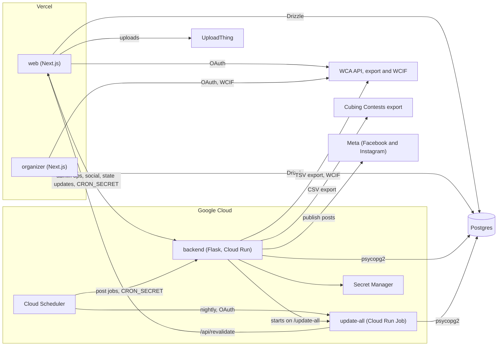

# Architecture

How the apps in this monorepo fit together, and which one owns each kind of work. When adding a feature, check here first so logic ends up in the right place.

## Who owns what

**`@workspace/db`** ([packages/db](../packages/db))

- Single source of truth for the Postgres schema (Drizzle), migrations, and seed data.
- The Flask backend reads and writes the same tables with raw SQL. Any schema change goes through a Drizzle migration first.
- Schema changes and deploys: on push, the `migrate` job in CI applies migrations only after lint, tests and build pass, while Vercel (web and organizer, promoted to production only after the CI checks pass) and a Cloud Build trigger (backend, gated on its own lint and unit tests; see its README) deploy independently, usually before the migration runs. Every migration must work with both the old and the new code. Use expand/contract: add the new column or table in one PR, ship the code that uses it in a later PR, and drop the old one after that. The `Migrate database` workflow is only for manual re-runs.

**backend (Flask)** ([apps/backend](../apps/backend))

- WCA TSV export import (`/update-database`) and the full nightly pipeline (`/update-all`).
- Cubing Contests CSV export import (`/update-cubing-contests`, also run at the end of `/update-all`): unofficial events held at WCA competitions in Mexico or with Mexican competitors, stored in the `cc_*` tables.
- Bulk recomputation across all states: state ranks, state records, Kinch, sum of ranks, streaks, nemesis stats, and competition round dates (WCIF).
- Social posts: image rendering (PIL), captions, and publishing to Facebook and Instagram.
- Every mutating endpoint is protected by `require_cron_auth` (bearer `CRON_SECRET`). Cloud Scheduler calls them, and so does the web app through `BACKEND_URL` (superadmin ops and social pages, and single-state updates after roster edits).
- The nightly `/update-all` pipeline runs as a Cloud Run Job ([`run_job.py`](../apps/backend/run_job.py)) that Cloud Scheduler starts directly; `POST /update-all` starts the same job and returns 202.
- A small public read API (`/competitions`, `/persons`, `/teams`, `/states`, `/rank/...`, `/records/...`, `/competitor-states/...`), documented on the web app's `/docs` page. Nothing in this repo calls it anymore; it stays for external consumers.
- `/update-all` records each run's per-step progress in `job_runs`, so `/update-all/resume` can continue a failed run from the step that failed.

**web (Next.js)** ([apps/web](../apps/web))

- The public site: rankings, records, persons, teams, competitions, summaries, and comparisons. Reads go straight to Postgres via Drizzle with Cache Components.
- Auth via `@workspace/auth` (Better Auth + WCA OAuth), shared with the organizer app.
- Team management and superadmin server actions.
- Single-state updates when a team edits its roster: [`lib/state-updates.ts`](../apps/web/lib/state-updates.ts) clears the moved people's markers and asks the backend to recompute the affected states (also behind `/api/update-state-ranks` / `/api/update-state-records`). Roster edits therefore need `BACKEND_URL` and `CRON_SECRET`.
- `POST /api/revalidate` (bearer `CRON_SECRET`): the backend calls it after `update-all` to revalidate an allowlist of cache tags.
- Superadmin "ops" and social pages that proxy to the Flask backend instead of reimplementing jobs.

**organizer (Next.js)** ([apps/organizer](../apps/organizer))

- Printables (certificates, badges, scorecards), the competition desk, and groups. See [organizacion-roadmap.md](./organizacion-roadmap.md).
- Reads WCIF from the WCA, and its own designs, teams, states and competitors' states from Postgres via Drizzle. It doesn't call the Flask backend.

## Known duplication

State ranks and state records are computed only by the backend ([`routes/admin/state.py`](../apps/backend/routes/admin/state.py)): for every state after each WCA import, and for one state when the web calls `POST /update-state-ranks/<state_id>` and `/update-state-records/<state_id>` after a roster change.

The SR rule itself has a TypeScript copy: [`lib/mark-state-records.ts`](../apps/web/lib/mark-state-records.ts) tags UNR/USR for Cubing Contests results on the fly. Both suites run [`fixtures/parity/state-records.json`](../fixtures/parity/state-records.json) against it and `_mark_state_records`.

Nemesis counts are computed twice: [`nemesis_stats.py`](../apps/backend/nemesis_stats.py) (all pairs, fed by `update_nemesis_stats`) and `apps/web/app/(root)/persons/_lib/nemesis-queries.ts` (one person at a time). Both integration suites check them against [`fixtures/parity/nemesis.json`](../fixtures/parity/nemesis.json), in both event scopes.

Both sides must apply the same rules: tie handling, official events, the 9i2 effective date, and the marker hierarchy described in [state-records.md](./state-records.md). An event is official when `events.rank < 800`, matching the WCA's `Event.official`. Use the shared helpers (`apps/web/lib/official-events.ts`, `OFFICIAL_EVENTS_SUBQUERY` in `apps/backend/common.py`) rather than event id lists. When you change ranking or record logic, update both implementations.

## Event scopes

Pages that count events accept `?deprecated=true`, which switches from the `official` scope to `all` (official plus the deprecated events with rank 990-999). Unofficial events such as `fto` never count.

- State ranks and SR markers are stored for the `all` scope, and readers filter them to their scope.
- `sum_of_ranks`, `kinch_ranks`, `streak_ranks` and `nemesis_stats` store one set of rows per scope (`scope` is part of the primary key). The backend jobs in `routes/admin/rankings.py` compute both scopes on every run.

See `.cursor/rules/official-events.mdc` for the helpers to use.

## Unofficial events (Cubing Contests)

Unofficial events held at WCA competitions (FTO, Mirror Blocks, Team-Blind, and so on) come from the [Cubing Contests](https://cubingcontests.com/export) export (CC BY-SA 4.0, attributed with `CcAttribution` wherever they are shown). They live only in `cc_events`, `cc_persons`, `cc_results` and `cc_result_persons`, never in `events`, `results` or `ranks_*`, so they are outside both event scopes and never feed state ranks, records, Kinch, SOR, streaks or nemesis.

- Official WCA events are never imported from Cubing Contests (CC category 5, or an id with `events.rank < 800`).
- The site footer (`DataSourcesNotice`) credits both sources with the dates of the last imported exports (`export_metadata` keys `wca_export_date` and `cubing_contests_export_date`), as the WCA asks of sites using its export.
- `cc_persons.wca_id` has no foreign key: CC competitors may lack a WCA id or be foreigners missing from `persons`. Readers left-join `persons` to link profiles and get states.
- Team events store one `cc_result_persons` row per member. Rankings treat the sorted member set as one competitor.
- The web reads them in [`lib/cubing-contests-queries.ts`](../apps/web/lib/cubing-contests-queries.ts) and shows them on the competition results "No oficiales" tab, the person "No oficiales" tab, `/unofficial/rankings` and `/unofficial/records`. They also appear, always in their own block and never in official totals, on:
  - The competition "Eventos" tab, the "Podios" tab ("Podios no oficiales") and the "Por persona" tab (under each person).
  - The person header ("Récords personales no oficiales") and the team page ("Récords estatales no oficiales").
  - The person and team annual summaries ("Eventos no oficiales" section, excluded from share cards).
  - Links from `/records` and the rankings event selector.
  - Person profile "Medallas no oficiales" / "Récords no oficiales" and the "Podios" tab; team page "Podios en eventos no oficiales".
- Unofficial ranks and records use their own labels, UNR and USR, so they're never confused with NR/SR. USR ranks a competitor (or team) within a state; a team counts for every member's state.
- UNR/USR record markers are computed on the fly in [`lib/cubing-contests-records.ts`](../apps/web/lib/cubing-contests-records.ts) with the same rules as official SR (`markStateRecords`: best result per calendar day, ties all count, a national record is never also a state record). `getCcRecordMarkers` caches them for every result; `/unofficial/records?show=history` lists the national or state progression. Rankings and records are computed on the fly from the stored results; there is no Python mirror.

## Related docs

- [state-records.md](./state-records.md): how state records are determined
- [web-hosting-constraints.md](./web-hosting-constraints.md): Vercel free-tier limits that shape `apps/web`
- [Backend README](../apps/backend/README.md): endpoints, cron jobs, and social posts
